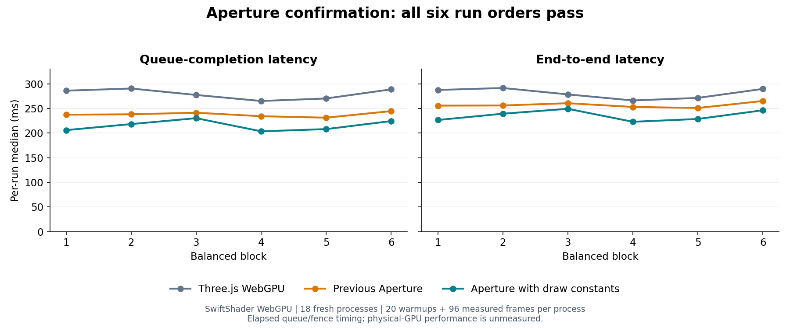

# Render-plan architecture experiment — 2026-10-14

The flat draw-constant implementation now passes a longer confirmation across
**all six run orders**: queue-completion medians were **17.0%–28.0% lower than
Three.js WebGPU**, and end-to-end medians were **10.5%–21.2% lower**. All 18 fresh
native runs passed, all 1,728 measured frames retained the workload, and all 54
reference images matched exactly. This confirms the earlier two-order result
without pooling their samples. Physical-GPU performance remains unmeasured;
these are controlled SwiftShader software WebGPU results.

## Scope and design

The main thread derives one typed render plan from extracted snapshot facts. Its feature selection, light ABI, binding schema, pipeline layout and frame resources share that plan. The worker/extraction boundary remains intact. Device-owned explicit layouts have bounded admission and a general fallback. Numeric light updates retain buffer-version behavior; structural changes select matching variants. Transmission declares a scene-color producer and consumes its actual texture before HDR scene draws.

The retained code is a research implementation. Small-light uniforms remain disabled. The losing shadow-facing and vertex-UV shortcuts were removed from live composition; their source and measurements are preserved. The latest admitted ordinary-light path uses fixed storage array lengths, evaluates Schlick's fifth power by multiplication, and prepares draw-constant terms in the vertex stage with flat transport to the fragment stage. Scene data, packed light data, rendering features and sampling counts are preserved. Pure plan caching remains without a separate performance benefit claim. See [design](../../docs/RENDER_PLAN.md) and [decision 0024](../../docs/DECISIONS.md).

## Controlled measurements

These are causal diagnostics of an existing controlled workload, not new independent author rounds. They do not reuse a concept image to score a new author round. Future author rounds still require a different feasible low-poly reference image for each round.

Both engines use **WebGPU**. This environment exposes **SwiftShader software WebGPU**, not a physical GPU. “Queue” is elapsed queue-completion latency measured with a fence, not a hardware GPU timestamp. CPU submission and end-to-end latency are retained separately.

The first two comparisons ran five variants serially in one order and then in reverse, with fresh native runs, five warmup frames, twelve measured frames and three diagnostic views per run. Other agents and root builds were quiet during timed windows. The scene, geometry, camera, resolution (1024×768, DPR 1), ACES exposure 1, 4× MSAA and public shadow recipe were fixed. There is no IBL, bloom or SSAO. Static shadows are reused. Aperture has 12 steady draws and Three.js 13, each with two passes and 25,725 triangles. The engines retain their own PCF algorithms; this is not an identical-kernel comparison.

Their gate was declared before rendering: at least 10% lower median queue time than the prior owner-specialized Aperture in **both** orders, improvement greater than reference drift, and no median end-to-end regression. No candidate in those first two comparisons passed. A comparison window is evaluated against its own contemporaneous reference; medians from different windows are not pooled.

### Initial plan and uniform transport

All values below are per-run medians in milliseconds. Each cell lists first / reverse order.

| Variant                |             Queue | CPU submission |        End to end |
| ---------------------- | ----------------: | -------------: | ----------------: |
| three-baseline         |   239.93 / 234.60 |    1.39 / 1.47 |   241.32 / 236.16 |
| aperture-original      | 1607.54 / 1795.16 |  14.14 / 14.88 | 1623.41 / 1810.16 |
| aperture-owner-v4      |   242.08 / 249.79 |  15.81 / 15.99 |   257.89 / 263.33 |
| aperture-typed-storage |   246.68 / 247.00 |  19.87 / 21.46 |   269.48 / 269.01 |
| aperture-small-uniform |   258.64 / 309.74 |  22.10 / 21.93 |   281.87 / 330.81 |

Plan SHA-256: `b995bec8c5208692cff3d372d7336020f1c9ababd1822abe31915e78013eb82d`.

### Cached plan and facing shortcut

All values below are per-run medians in milliseconds. Each cell lists first / reverse order.

| Variant                |             Queue | CPU submission |        End to end |
| ---------------------- | ----------------: | -------------: | ----------------: |
| three-baseline         |   270.17 / 244.80 |    1.44 / 1.34 |   272.01 / 246.33 |
| aperture-original      | 1663.10 / 1494.70 |  15.15 / 14.65 | 1678.40 / 1509.35 |
| aperture-owner-v4      |   275.16 / 261.52 |  16.26 / 16.16 |   291.45 / 278.90 |
| aperture-typed-storage |   273.03 / 303.57 |  20.82 / 22.01 |   296.50 / 327.26 |
| aperture-facing-shadow |   278.65 / 268.10 |  20.16 / 20.82 |   298.41 / 288.96 |

Plan SHA-256: `b029a803151d9f0dbd427891434dfdffbc1caecdc5d262e1877881019d99590f`.

Across both comparisons, all twenty native children closed successfully, with no reported validation errors or device loss. Candidate rasters exactly matched the retained Aperture reference and corresponding Aperture comparisons. This does **not** assert pixel equality between Aperture and Three.js. Independent review checked actual submitted pipelines, whole shader sources, native resource/buffer ranges, artifact receipts and source pins. Steady measured frames created no new GPU resources.

The original Aperture queue time was about 1.5–1.8 seconds; owner specialization reduced it to roughly 0.24–0.28 seconds. The shared-plan candidates did not improve on that specialization. The uniform candidate regressed in both orders. After CPU plan caching, storage queue time changed by +0.8% / −16.1% relative to owner (positive means faster), and the facing candidate by −1.3% / −2.5%; all end-to-end gates failed.

### Fixed shadow-buffer offsets

A follow-up changed only the reachable shadow-parameter resolver in the earlier
owner-specialized renderer. It replaced the owner-dependent address chain with
literal storage offsets, preserving runtime count guards, arithmetic, defaults,
PCF and storage layout. A private historical runtime was reconstructed from
retained bytes so newer host changes could not enter the comparison. Only the
shader specialization module differed. This candidate was **not integrated**.

The later [acceptance goal](GOAL.md) applied here: at least 10% lower median queue
time than contemporaneous Three.js in both orders, a gain larger than Three.js
cross-order drift, and no end-to-end regression against either Three.js or the
previous Aperture specialization. The fixed order was Three.js / previous
Aperture / candidate, then reverse. Each run used five warmup frames, twelve
measured frames and three diagnostic views, with other CPU work paused.

| Variant                 | Queue, first / reverse | CPU submission |      End to end |
| ----------------------- | ---------------------: | -------------: | --------------: |
| Three.js                |        220.60 / 270.80 |    1.46 / 1.49 | 224.52 / 272.28 |
| Previous specialization |        288.74 / 273.59 |  17.17 / 16.16 | 309.36 / 292.12 |
| Fixed shadow offsets    |        243.46 / 279.55 |  15.14 / 16.16 | 257.51 / 294.51 |

Values are per-run medians in milliseconds. Plan SHA-256:
`36376be1504cc07b6492e7d5c26ffbcf86871ccaa28c8c7f9baa71a3aeb41420`.

The candidate was 10.4% / 3.2% slower than Three.js on queue completion. It also
regressed end-to-end against Three.js in both orders and against prior Aperture
in reverse order. Three.js reference drift was 50.205 ms. **Both acceptance gates
failed.** All six native children completed successfully, all six paired
Aperture images matched exactly, and measured frames had no resource churn.
The separate one-frame smoke passed but supplied no performance evidence.

The [focused evidence summary](shadow-offsets/summary.json),
[independent comparison review](shadow-offsets/independent-comparison-review.json)
and [native object review](shadow-offsets/independent-native-review.json) retain
the result. The [manifest](shadow-offsets/manifest.json) and
[reconstruction instructions](shadow-offsets/RECONSTRUCTION.md) preserve the
failed preparation, exact candidate source, raw runs and helper inputs.

### Fixed storage and Fresnel multiplication

The fixed-storage path admits exactly one ambient light and one ordinary PCF sun
through the render plan. Its explicit layout keeps the existing three light
bindings, with minimum byte sizes 232, 48 and 64. WGSL arrays have lengths 58, 12
and 1, allowing the compiler to see constant lengths instead of dynamic storage
array queries. Layout-budget fallback selects the original dynamic shader before
compilation. The selected candidate also replaces the Schlick `pow(x, 5)` with
three multiplications. This preserves the BRDF but can change floating-point
rounding; image equality was checked rather than assumed.

The final window used 12 warmup frames and all 36 measured frames per fresh run:
Three.js / owner-v4 / fixed storage / fixed storage with Fresnel multiplication,
then reverse. No repository check or other root build ran during these timings.
The same verified Chromium-cache retirement policy applied after every closed
native child. Medians use the declared nearest-rank statistic, without exclusions.

| Variant                    | Queue, first / reverse | End to end, first / reverse |
| -------------------------- | ---------------------: | --------------------------: |
| Three.js WebGPU            |      239.220 / 265.165 |           240.580 / 266.440 |
| Previous owner-v4          |      283.995 / 255.050 |           300.645 / 270.400 |
| Fixed storage only         |      218.300 / 216.310 |           236.530 / 234.925 |
| Fixed storage with Fresnel |      204.385 / 224.215 |           221.645 / 240.885 |

Values are milliseconds. Final plan SHA-256:
`873fd976f32ba4c4f618797ccae1d87e2931493ef9e9d7dc7c1569e2b01eab32`.

The selected candidate's queue gains versus Three.js were 34.835 / 40.950 ms,
both larger than Three.js cross-order drift of 25.945 ms. End-to-end time was
7.9% / 9.6% lower than Three.js. Thus the original Three.js/owner goal passed
within this window. The stronger predeclared parent-control guard **failed**:
reverse-order end-to-end time was 5.960 ms (2.5%) above fixed storage alone.
The entire experimental benefit gate remains false, and there is no reliable
incremental Fresnel benefit claim.

Earlier windows remain part of the evidence. The first private fixed-storage
probe passed its gates, but live integration and the longer fixed-only
confirmation did not. That confirmation measured 5.5% / 11.9% queue reductions
versus Three.js and failed forward end-to-end latency. Vertex UV relocation was
reverted after a 17.6% reverse-order end-to-end regression against fixed storage.
A finite-normal shortcut was rejected when one channel of one pixel differed.
There are no pooled medians or replacement of failed attempts with later runs.

All eight final native children and their lifecycle wrappers closed with exit
zero. All 288 samples preserved the workload and created no new steady-frame
GPU resources. All 24 diagnostic reference images and six owner/candidate paired
images matched exactly within their respective engine baselines. This does not
assert pixel equality between Three.js and Aperture. The separate safety010
candidate covered 43 states and 94 worker frames; all 50 full images and both
canonical restorations matched the explicitly reused safety009 general-renderer
baseline. Native binding, transmission and disposal checks passed. Uploaded-word
evidence records API calls rather than GPU memory readback. These recalculations
were performed by the root agent, not an independent reviewer.

See the [six-probe summary](shader-probes/summary.json),
[final summary](fixed-storage/summary.json),
[final comparison recalculation](fixed-storage/reports/fixed-light-storage-fresnel-001/comparison-recalculation.json),
[native safety review](fixed-storage/reports/safety-010/native-final-review-001.json)
and [reconstruction instructions](fixed-storage/RECONSTRUCTION.md).

The final [archive manifest](fixed-storage/manifest.json) retains 16,218 original
file identities as 3,511 unique payloads in five verified archives totaling
58,309,578 bytes. A full restoration reproduced all 16,218 files, and a separate
readback verified every size and SHA-256. The earlier six-probe batch remains
immutable; its three archives total 49,036,453 bytes. Both batches preserve
negative outcomes and failed preparations.

### Opaque-discard deletion: rejected

An opaque-only discard deletion passed image and native correctness checks but
failed the complete timing gate. Queue reductions versus Three.js were 16.2% /
9.1%; reverse order missed the 10% threshold and regressed end-to-end against
the committed Fresnel control. The change was reverted before the next candidate.
Its failed fixture preparations, successful 48-state native qualification, raw
samples and exact source remain in the [opaque-discard evidence](opaque-discard/RECONSTRUCTION.md).
No unchanged timing retry replaced that outcome.

### Flat draw constants: accepted software result

The selected change moves calculations that are constant across a draw out of
the fragment stage: sun direction, sun and ambient radiance, shadow parameters,
and base-color UV sine/cosine. Four flat `vec4` varyings carry the results from
the vertex stage. It preserves the live light packet and the original WGSL
functions. UV coordinate arithmetic, normal processing, BRDF, alpha discard and
shadow samples stay in the fragment stage. Explicit buffer visibility comes from
the same render plan. Unsupported variants and layout-budget fallback retain
the general path.

The declaration preceded native rendering: six roles forward, then reverse,
12 warmup frames and all 36 measured frames per fresh run. Its gate required at
least 10% lower queue time than Three.js in both orders, gains beyond Three.js
cross-order drift, and no end-to-end regression against **any of the five controls**.
No build or repository test overlapped the timing window. The same cache retirement
policy applied after every closed native child.

| Variant                          | Queue, first / reverse | End to end, first / reverse |
| -------------------------------- | ---------------------: | --------------------------: |
| Three.js WebGPU                  |      234.340 / 234.155 |           235.660 / 235.485 |
| Previous owner-v4                |      266.810 / 244.420 |           279.880 / 259.480 |
| Fixed storage only               |      236.430 / 220.945 |           256.135 / 240.085 |
| Committed fixed-storage/Fresnel  |      218.685 / 210.645 |           237.430 / 230.105 |
| Rejected opaque-discard deletion |      209.685 / 202.000 |           228.950 / 221.730 |
| **Flat draw constants**          |  **195.255 / 200.175** |       **213.400 / 220.240** |

Values are per-run nearest-rank medians in milliseconds. Plan SHA-256:
`c5c78905e96dcaac0b62b41b13693d6f4b0583f563a37d2c6c85d8f477615f2a`.

Queue gains were 39.085 / 33.980 ms, both above the 0.185 ms Three.js drift.
All ten end-to-end control comparisons passed. All 12 native runs closed with
exit zero; all 432 samples retained the workload without steady-frame resource
churn. Reference images matched exactly within each engine, including all three
views in the preceding native smoke. This does not assert pixel equality between
Aperture and Three.js. Artifact recalculation was by the root agent, not an
independent reviewer.

The fresh native correctness qualification compared the general renderer and
candidate across 52 states, 112 worker frames and 59 images per mode. Every
paired image matched exactly. Positive and negative UV rotation, light direction
and color, shadow-parameter changes and restoration were exercised. Native
shader call graphs and actual pipeline layouts confirm vertex preparation and
matching buffer visibility; numeric transitions created no new pipelines.
Lighting/material transitions, transmission resource joins, worker termination
and buffer/texture disposal all passed. Uploaded-word evidence describes native
API call boundaries, not GPU memory readback.

### Longer confirmation across all six run orders

The implementation at `11463da4cff8f39f6426895f9d9ea1eebff50841` was tested
unchanged against Three.js and its previous fixed-storage/Fresnel parent. The
new declaration used all six permutations of those three roles: 18 fresh native
processes, 20 warmup frames and all 96 measured frames per process. Each role
appeared first, middle and last twice. The scene, runtime, instrumentation and
cache-maintenance policy remained fixed; no builds or tests overlapped timing.
This is a controlled confirmation, not a new independent author round.

Every block had to show at least 10% less queue time than its contemporaneous
Three.js control, a gain exceeding the range of all six Three.js medians, no
end-to-end regression against either control, and exact images. **All six
blocks passed.** No samples were excluded and no failed window was replaced.

| Block order            | Three.js queue | Previous Aperture queue | New Aperture queue | Queue reduction vs Three.js |
| ---------------------- | -------------: | ----------------------: | -----------------: | --------------------------: |
| Three / previous / new |        286.200 |                 237.435 |            206.165 |                       28.0% |
| Previous / new / Three |        290.605 |                 238.320 |            218.440 |                       24.8% |
| New / Three / previous |        277.510 |                 241.480 |            230.415 |                       17.0% |
| Three / new / previous |        265.285 |                 234.390 |            203.725 |                       23.2% |
| New / previous / Three |        270.410 |                 231.410 |            208.265 |                       23.0% |
| Previous / Three / new |        288.905 |                 244.775 |            224.535 |                       22.3% |

Values are nearest-rank per-run medians in milliseconds. Queue gains of
47.095–80.035 ms all exceeded the 25.320 ms Three.js reference range. Queue
latency was also 4.6%–13.2% lower than the previous Aperture version. End-to-end
latency was lower than both controls in every block. The earlier window remains
a separate result; the larger gains here do not imply a further code change.

Plan SHA-256:
`b9aca769c9f17db6f8fe72b5e4e231dc62428f40d8ae8b18f5795ebcd5f45a1b`.

The root recalculation verified all 1,728 samples, actual child/lifecycle exits,
submitted shader sources, native binding ranges, exact ordinary reference images
and all 18 parent/candidate image pairs. Source and numeric settings are frozen.
The unchanged implementation explicitly reuses its 52-state native correctness
qualification. See the [confirmation summary](flat-draw-confirmation/summary.json),
[raw-data recalculation](flat-draw-confirmation/reports/comparison-recalculation.json)
and [reconstruction instructions](flat-draw-confirmation/RECONSTRUCTION.md).

## Disposition

The narrow draw-constant implementation satisfies the declared software
performance target. Prior failed comparisons remain failed, and medians from
different windows are never pooled. CPU submission overhead remains; this result
does not establish general renderer superiority or physical-GPU performance.
Delivery is a research-branch implementation, without a merge or release.

## Repository validation and evidence

The fresh full check after the six-order confirmation reproduced **5,351 passing
tests and four failures**, with all pre-test stages passing. Each failure again
explicitly reports missing `/opt/google/chrome/chrome`. All 1,819 benchmarked
renderer source/build files and the reused native qualification reports still
match their hashes. See the [confirmation validation receipt](flat-draw-confirmation/reports/repository-validation.json)
and [source verification](flat-draw-confirmation/reports/final-source-validation.json).

The confirmation's two archives total 18,603,109 bytes. A fresh restoration and
separate readback verified all 4,984 original files (159,405,162 bytes), including
their hashes and modes. See the [restoration review](flat-draw-confirmation/restoration-review.json).

The selected flat draw-constant source completed `pnpm run check`: **5,351 tests
passed and four CLI rendering tests failed** (726 test files passed, one failed).
All four failures explicitly report missing `/opt/google/chrome/chrome`, including
the previously opaque `frame_capture` failure. Every pre-test stage passed:
builds, type checks, package checks, docs, lint and formatting. The focused renderer
suite passed 63 tests across five files. All 1,819 benchmarked renderer source and
build files still match after validation. This is an explicitly incomplete full
suite with an identified environment blocker, not an all-green result.

The first check attempt rejected a new evidence-registration timestamp before
tests. That invalid manifest remains unchanged as a retained failed packaging
attempt. A new registration made with the repository sealer fixes the metadata;
benchmark artifacts were not changed. Exact logs and receipts are in the
[validation report](flat-draw-constants/reports/repository-validation.json).

The [winning summary](flat-draw-constants/summary.json),
[comparison recalculation](flat-draw-constants/reports/comparison-recalculation.json),
[native correctness review](flat-draw-constants/reports/safety-015/native-final-review-001.json),
[numeric update review](flat-draw-constants/reports/numeric-qualification-review.json)
and [reconstruction instructions](flat-draw-constants/RECONSTRUCTION.md)
retain the declaration, exact source, all native attempts, raw samples and checks.
The six verified archives total 68,009,562 bytes. A fresh restoration reproduced
all 19,957 original regular files (987,900,542 bytes), and a separate readback
verified every hash, byte count and mode; see the
[restoration review](flat-draw-constants/restoration-review.json).

The previous fixed-storage/Fresnel source completed a fresh `pnpm run check` with
**5,347 passing tests and four CLI rendering failures** (726 test files passed,
one failed). All pre-test stages passed, including builds, type checks, docs,
lint and formatting. Three failures explicitly report missing
`/opt/google/chrome/chrome`; the fourth reports `frame_capture` returning
`ok: false` without its underlying diagnostic. It uses the same browser-dependent
CLI path, but this log does not independently establish its cause. The focused
renderer suite passed all 36 tests across five files. The approved native route
separately passed the rendering and safety checks above.

An earlier full-check attempt stopped without a final exit receipt; its partial
log is retained and is not counted as passing. The complete later check closed
with exit code 1. See the [exact validation receipt](fixed-storage/reports/fixed-light-storage-fresnel-001/repository-validation.json).
Checks ran in the shared working tree; unrelated pre-existing edits remain
outside this delivery. All 1,818 final renderer source/build pins match the
benchmarked inventory.

The earlier architecture source completed `pnpm run check` through all pre-test checks. Vitest
reported 5,345 passing tests and four CLI browser-rendering failures because
`/opt/google/chrome/chrome` is unavailable. No alternate browser was installed.
This is an explicitly incomplete full-suite result, not an all-green check.

The [evidence manifest](evidence/manifest.json) retains 139,014 original file
identities as 7,250 deduplicated raw payloads in three verified gzip archives
(total 47,851,852 bytes). All source/build failures and native attempts remain.
See the [readable summary](evidence/summary.json),
[reconstruction instructions](evidence/RECONSTRUCTION.md) and
[exact freeze](freezes/architecture-comparisons.json). Safety and validation
closures are separate addenda. The [acceptance goal](GOAL.md) records the later
Three.js advantage criterion and the user-confirmed physical-GPU blocker.

### Final native correctness closure

The [validation addendum](validation/RECONSTRUCTION.md) retains 17,430 regular
file identities as 2,145 verified payloads in six archives. It includes the
unattempted safety007 preparation and the failed safety008 verifier attempt.
That verifier incorrectly required every transmission consumer to have a direct
positive draw; the actual pass had nine indirect consumers and one direct
consumer. Safety009 corrected the witness without changing renderer source.

All four safety009 native runs closed successfully. The two full runs each
covered 43 states, 94 worker frames and 50 images. All 50 paired images and both
canonical restorations matched exactly, with no native validation errors or
device loss. Independent review checked 173,530 current light-buffer words per
full mode, actual binding and transmission resource joins, and worker disposal.
The general and storage modes disposed 2,063/2,063 and 2,079/2,079 buffers,
respectively, and 37/37 textures each, leaving zero live buffer bytes.

See the [native summary](validation/native-summary.json),
[independent review](validation/native-independent-review.json) and
[repository check outcome](validation/full-check-outcome.json). These establish
correctness on software WebGPU. They do not establish hardware speed, per-fragment
shader invocation counts, or indirect transmission draw counts.
