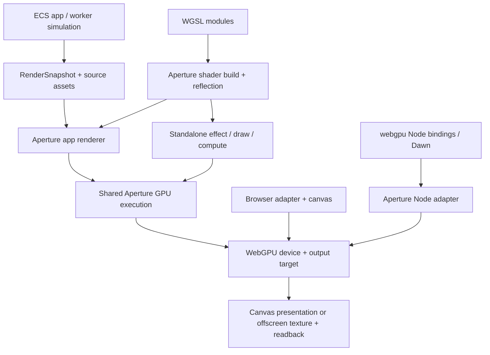

# Shader Authoring And Dawn-Backed Node Rendering

Date: 2026-10-16
Status: complete — implemented and verified on 2026-10-16
Baseline: Aperture `8b8275b`; vgpu `v0.6.0` reviewed as an architectural reference

## Goal And Decisions

Make Aperture a strong environment for both complete applications and shader-driven
work, and give Aperture's tooling its own native WebGPU rendering route in Node.js.

The Node route will use **Dawn directly through the `webgpu` Node bindings**.
There will be **no dependency on `vgpu`, `vgpu/node`, or `@vgpu/*`**, and no reliance
on vgpu's installers, caches, shader artifacts, or runtime. vgpu is a reference for
developer experience and architecture. Aperture owns its renderer and tooling.

Deliver these outcomes:

1. Render Aperture bundles to images in Node without launching Chromium, serving
   a page, or creating a canvas or display server.
2. Keep one Aperture rendering implementation across browser and Node: materials,
   lighting, shadows, post-processing, render graph, and diagnostics.
3. Let authors build fullscreen effects, procedural draws, and compute pipelines
   without creating an ECS world, then reuse those shaders in full Aperture apps.
4. Make custom materials easy to integrate with Aperture's lighting and other
   render passes, while retaining an explicit fully custom shader route.
5. Make shader compilation, bindings, resource lifetime, and failures inspectable
   through the editor, CLI, and MCP tooling.

**Ship native Node rendering first.** It does not depend on completing the shader
authoring redesign or extracting a new GPU foundation package.

## What The Comparison Suggests

The comparison and gap tables below describe the reviewed baseline; the implementation
checklist at the end records the completed changes.

Both projects use **WGSL** for WebGPU shaders and TypeScript/JavaScript for host
orchestration. Module imports/exports are build-tool extensions around WGSL;
the GPU ultimately receives ordinary WGSL. Changing shader language would not
address Aperture's main gaps.

| Area                         | Aperture today                                                                                    | Useful lesson from vgpu                                       | Aperture direction                                                                  |
| ---------------------------- | ------------------------------------------------------------------------------------------------- | ------------------------------------------------------------- | ----------------------------------------------------------------------------------- |
| Full application development | ECS, worker simulation, snapshots, assets, lighting, UI, application tooling                      | Small GPU abstractions can also serve larger applications     | Preserve application architecture and improve the GPU layer underneath it           |
| Shader entry point           | Custom materials, post effects, and user passes exist, but require substantial renderer knowledge | Shader-first draw, effect, and compute workflows reduce setup | Add a small standalone surface using the same executor as the app renderer          |
| Shader modules               | Existing custom material route accepts source and explicit binding descriptions                   | Reusable modules and prepared reflection reduce duplication   | Compile modular WGSL into Aperture-owned, versioned artifacts                       |
| Binding safety               | Custom binding conventions and low-level pass APIs expose layout details                          | Named bindings and reflected layouts provide earlier errors   | Generate packing/layout information and validate against actual device capabilities |
| Node rendering               | CLI runs the browser render harness and captures its canvas                                       | Dawn can execute WebGPU directly in Node                      | Build Aperture's own Dawn adapter, output target, and readback route                |
| GPU diagnostics              | Existing reports cover rendering and resource failures                                            | Errors should identify shader source, binding, and operation  | Preserve existing reports and connect them to shader artifacts and graph passes     |

The current GPU work is a foundation to extend, not a rewrite target. In
particular, Aperture already has graph ordering, resource lifetime descriptions,
history resources, render/compute command recording, and offscreen attachment
helpers.

### Concrete Gaps In The Current Code

| Location                                                                                             | Current constraint                                                                                                      | Planned change                                                            |
| ---------------------------------------------------------------------------------------------------- | ----------------------------------------------------------------------------------------------------------------------- | ------------------------------------------------------------------------- |
| [`initialize-webgpu.ts`](../../packages/webgpu/src/gpu/initialize-webgpu.ts)                         | Adapter discovery, device creation, and canvas configuration are coupled                                                | Separate device negotiation from presentation; accept an explicit device  |
| [`create-webgpu-app.ts`](../../packages/webgpu/src/app/create-webgpu-app.ts)                         | Renderer construction follows browser initialization                                                                    | Extract construction from a supplied device and output target             |
| [`current-texture-view.ts`](../../packages/webgpu/src/app/presentation/current-texture-view.ts)      | Canvas-current-texture and offscreen helpers exist as separate entry points                                             | Introduce an output-target contract used by both                          |
| [`driver.ts`](../../packages/cli/src/render/driver.ts)                                               | Session implementation and metadata require a browser                                                                   | Dispatch to independent Dawn and browser implementations                  |
| [`render-harness.main.js`](../../packages/cli/assets/render-harness/render-harness.main.js)          | Bundle hydration, environment preparation, and renderer setup live inside the browser harness                           | Share environment-neutral bundle preparation and rendering                |
| [`user-pass.ts`](../../packages/webgpu/src/app/user-pass.ts)                                         | Custom render passes currently overlay scene color; arbitrary declared render targets are diagnosed rather than honored | Implement actual attachment routing and resource contracts                |
| [`custom-wgsl-material.ts`](../../packages/webgpu/src/materials/custom-wgsl/custom-wgsl-material.ts) | Fixed engine binding/vertex conventions and a separate custom pipeline family                                           | Add reflected bindings and supported material extension points            |
| [`custom material recipe`](../recipes/custom-wgsl-material.md)                                       | Authoring requires explicit WGSL and binding agreement                                                                  | Keep compatibility while adding modular artifacts and generated contracts |

## Architecture



The engine continues to own graph scheduling and submission. Helpers record work
into that execution path; they do not introduce a second scheduler or independently
submit commands halfway through an engine frame.

For full applications, ECS remains authoritative and `RenderSnapshot` stays
explicit and serializable. Standalone GPU programs have explicit input data and
resources, without acquiring a scene graph or hidden gameplay authority. Record
this narrower standalone scope in [`DECISIONS.md`](../DECISIONS.md) when implementing
it, including the corresponding exception to app-only example conventions.

### Package Boundaries

Names below are proposed public package names; the phases define when to add them.

| Package                         | Responsibility                                                                      | Dependency constraint                                                                                 |
| ------------------------------- | ----------------------------------------------------------------------------------- | ----------------------------------------------------------------------------------------------------- |
| `@aperture-engine/webgpu`       | Existing app renderer, material realization, render passes                          | Browser-safe; never imports native bindings or Node tooling                                           |
| `@aperture-engine/adapter-node` | Direct Dawn initialization, adapter selection, device ownership, native metadata    | Depends directly on a qualified, pinned `webgpu` release; loaded only for native GPU work             |
| `@aperture-engine/shader`       | Portable artifact contracts and build-time WGSL module/reflection tooling           | Runtime contracts and compiler have separate exports; worker/runtime imports do not load the compiler |
| `@aperture-engine/gpu`          | Later extraction of reusable GPU resources, graph execution, and standalone helpers | No ECS, application runtime, UI, DOM, or Node dependency                                              |
| `@aperture-engine/cli`          | Bundle jobs, backend selection, PNG encoding, worker lifecycle, CLI/MCP reporting   | Dynamically loads the selected renderer; native dependency never enters browser apps                  |

Start with the adapter package and internal renderer seams. Extract shared GPU
code only after a standalone use case proves the boundary. Aperture's `webgpu`
package will then depend on its `gpu` package, never the reverse. Serializable
shader contracts must contain no GPU objects or GPU-global types, so
render/extraction packages can reference them.

Extend both package-boundary checks to cover the new packages and transitive
imports. The CPU-only headless simulation route must still run without loading
Dawn, creating a device, or importing browser rendering code. Add build references,
exports, release configuration, and packed-package checks as packages appear.

## Track A: Native Dawn Rendering For Aperture Tooling

### A1. Separate Device Creation From Presentation

Refactor browser initialization into three responsibilities:

1. Discover an adapter and negotiate required/optional features and limits.
2. Construct the Aperture renderer using that device and explicit capabilities.
3. Acquire the output attachment from a browser canvas or owned offscreen texture.

The browser facade keeps its current defaults. The renderer constructor accepts a
borrowed device and an output-target provider, with explicit ownership rules.
Renderer disposal destroys its resources; the adapter/session that created the
device destroys the device. Shared devices must never be destroyed implicitly.

The output contract specifies dimensions, format, color encoding, alpha convention,
sample count, acquisition, resize, and disposal. Acquire one output per frame and
pass it consistently through the graph. Reuse existing offscreen helpers. Node
rendering does not need a fake `navigator`, `HTMLCanvasElement`, or canvas context.

### A2. Implement Aperture's Direct Dawn Adapter

Use the upstream [`webgpu` bindings](https://github.com/dawn-gpu/node-webgpu), which
expose `create(options)` and WebGPU globals. The inspected source manifest is
version `0.6.1`; qualify the actual published artifact and pin its version and
lockfile integrity during implementation. A source version is not proof that its
prebuilt package works on every target machine.

The essential initialization is:

```text
load webgpu in the native renderer process
gpu = create(validated Dawn options)
adapter = await gpu.requestAdapter(adapter preferences)
inspect adapter.features and adapter.limits
device = await adapter.requestDevice(negotiated descriptor)
construct Aperture renderer(device, offscreen output)
```

Aperture owns:

- Required versus optional features, requested limits, and capability diagnostics.
  Required features fail explicitly; supported optional features follow the same
  policy as browser rendering. Report adapter support separately from enabled
  device features.
- `auto`, `hardware`, and `software` adapter policies. `hardware` must reject a
  software adapter. `software` must select a verified software implementation;
  it cannot mean "whichever adapter was returned." Report unknown adapter identity
  honestly, and fail strict policies when identity cannot be established.
- Platform qualification: initially Linux/Vulkan and a provisioned software Vulkan
  driver for CI; qualify Metal/macOS and D3D12/Windows separately. Native Vulkan or
  Metal underneath Dawn still exposes the same WebGPU renderer.
- Dawn instance lifetime, device-loss handling, uncaptured errors, and teardown.
  Keep a session reference to the object returned by `create`; release it on
  shutdown. Do not install a permanent global `navigator.gpu`: upstream documents
  that a retained instance can keep Node alive.
- Any required WebGPU constants/constructors. Prefer explicit constants where
  practical; if the binding's globals are needed, install them once in the dedicated
  native renderer process, before importing dependent code.

Use an Aperture-owned configuration surface. Do not read `VGPU_*` variables or
reuse vgpu's software-renderer cache. Software rendering requires a real provisioned
ICD/driver such as SwiftShader or Lavapipe; Dawn installation alone does not guarantee
one. Pin that runtime in CI and record its identity. Initialization must not silently
download drivers or change host configuration.

### A3. Offscreen Rendering And Readback

Render through the existing graph into an offscreen final-color texture with the
required attachment and copy usage. Preserve scene HDR, MSAA, shadows, IBL, bloom,
exposure, and tone mapping. Resolve multisampling before copying. Define the final
PNG encoding explicitly so tone mapping and linear-to-sRGB conversion each happen
once, matching the browser image contract.

Implement readback with:

- `copyTextureToBuffer` and a staging buffer with `COPY_DST | MAP_READ`.
- Rows aligned to WebGPU's 256-byte copy requirement, with padding removed after
  mapping; include widths that are not multiples of 64 pixels in tests.
- Explicit handling of RGBA/BGRA, orientation, opaque/premultiplied alpha, and
  output color metadata. Do not assume texture bytes equal browser screenshot bytes.
- Awaited submission/readback, scoped validation errors, and device-loss rejection.
  Copy mapped data into owned CPU memory before unmapping and destroying buffers.
- Dimensions checked against device limits and a bounded memory budget before
  allocation. Bound outstanding readbacks to prevent unbounded native memory use.

Use one-shot cleanup in `finally`, including initialization failures. A completed
PNG and healthy renderer report establish success; queue submission alone does not.

### A4. Share Bundle Preparation With The Browser Route

Move the environment-neutral portions of the browser harness into a shared
renderer module: snapshot decoding, typed-array hydration, source-asset registry
reconstruction, environment preparation, render options, and report collection.
The browser harness becomes an adapter around that module; Node uses regular ESM.

Keep strict bundle preflight and complete asset closure. Native rendering must
consume embedded bytes without fetching URLs or reading original application
assets. Audit image, compressed-texture, HDR/environment, and font/atlas decoding
for browser-only APIs; use explicit CPU decoders where necessary. Support the
formats declared by the bundle or return a precise unsupported-format error.
Do not substitute placeholders to make parity tests pass.

Preserve existing legacy-bundle migration behavior, dimensions, bundle digest,
blank-frame checks, material diagnostics, lighting health, and shadow coverage.
A `RenderBundle` remains renderer input; restoring simulation remains the separate
`SessionSnapshot` concern.

### A5. CLI, Warm Sessions, And MCP

Split [`driver.ts`](../../packages/cli/src/render/driver.ts) into a backend-neutral
session facade and lazily loaded browser/Dawn implementations. In particular,
remove its unconditional Playwright import from the native path.

Implemented commands:

```sh
aperture render frame.bundle.json --backend dawn --adapter software --out frame.png
aperture render frame.bundle.json --backend browser --out frame.png
```

Carry backend options through one-shot rendering, `render serve`, and the MCP
session manager's renderer factory. Preserve callers' serialization, timeout,
disposal, and accepted-work semantics. A headed browser dev session remains a
browser session; captures of portable bundles can use Dawn.

For CLI/MCP, use a dedicated Node child process that owns the Dawn instance and
device. A warm session reuses that process and device, initially creating fresh
per-job renderer state and resources to preserve current fresh-page isolation.
Negotiate a stable feature profile per session; explicitly restart or reject a
job requiring a different profile. Do not mutate Vulkan environment selection in
a process that has already initialized a different driver.

Serialize accepted jobs, reject new jobs after disposal starts, and drain accepted
work before normal shutdown. A hard timeout or native crash invalidates the
session: terminate and await the worker, fail affected jobs, and create a fresh
session only through an explicit recovery path. A JavaScript timeout is not proof
that native work stopped. Test parent exit, EOF, startup failure, device loss,
and repeated disposal. An in-process library adapter can remain available with
documented caller-owned lifecycle and weaker hard-cancellation guarantees.

Change metadata to a discriminated backend schema: `backend: "dawn" | "browser"`,
common WebGPU/device/output fields, Dawn binding/runtime information for native
jobs, and browser launch details only for browser jobs. Update consumers of the
currently mandatory `browser` field; do not fabricate browser metadata for Dawn.
Version machine-readable output where needed and provide migration notes.

Roll out with explicit `--backend dawn`. Make Dawn the default for portable Node
rendering after the Track A gates pass, independently of Track B. Retain explicit
browser rendering for browser integration checks. Native initialization failures
must give actionable diagnostics rather than silently launching a browser.

### A6. Native Rendering Acceptance Gates

- Render an existing lit Aperture bundle with shadows, IBL, textures, HDR, MSAA,
  and bloom when Chromium and `DISPLAY` are unavailable.
- Compare the same bundle through browser and Dawn using defined pixel tolerances
  and semantic regions, including shadow occlusion and lighting. A nonblank image
  alone is insufficient. Document deliberate color/alpha differences before
  changing baselines; do not assume bit-identical output across drivers.
- Cover custom WGSL, post effects, compute-to-render resources, missing features,
  invalid WGSL, unsupported assets, device loss, resize, and odd-width readback.
- Repeated warm renders at different sizes and with unrelated bundles do not leak
  state; memory stabilizes after warm-up; disposal lets the child exit cleanly.
- Native jobs never start a browser, static server, or Xvfb. CPU-only headless jobs
  never import the native binding. Browser bundles contain no native/Node modules.
- Run real Dawn tests on an explicitly provisioned software CI lane. A missing
  runtime is a failed required lane, not a passing mock test. Mocks remain useful
  for dispatch, metadata, and failure-path tests.
- Test packed, clean installations under supported Node versions and each claimed
  OS/architecture. Include native binary and runtime-library resolution, package
  manager install-script requirements, and actionable unsupported-platform errors.

Browser comparison runs in this cloud environment continue to use
[`render:cloud` / `runVerifiedScene`](../CLOUD_LOCAL_RENDERING.md). Add a distinct
native verification command and lifecycle documentation; never relabel a native
render as browser verification or weaken the existing browser route.

## Track B: Shader-Driven Authoring And App Integration

### B1. Modular WGSL And Aperture Shader Artifacts

Add a build-time module pipeline with reusable functions, structs, and constants,
deterministic dependency resolution, cycle/error reporting, and source maps.
Start with entry modules owning resource bindings; imported libraries should not
silently allocate bind groups. Keep raw `.wgsl` and inline source supported.

Produce an Aperture-owned, versioned artifact containing:

- Flattened WGSL, entry points, overrides, dependency hashes, and compiler version.
- Binding names, group/binding indices, resource kinds, access and visibility,
  texture/sampler constraints, and buffer layout information.
- Field offsets, alignment, matrix/array strides, minimum sizes, and a typed
  host-side packing contract; handle uniform and storage address spaces correctly.
- Required capabilities and source mappings back to authored files.

Select and qualify a suitable WGSL parser/reflection implementation behind this
contract; do not import vgpu's compiler or artifact schema. Avoid treating regex
extraction or TypeScript types as semantic WGSL validation. Runtime shader-module
diagnostics and asynchronous pipeline creation on the actual device remain the
validation authority.

Integrate the build pipeline with the Vite plugin and CLI. Keep compiler code out
of production runtime bundles. Offer explicit setup-time preparation for dynamic
WGSL, with equivalent validation and diagnostics, outside the frame hot path.

### B2. Resources, Bindings, And Complete Pass Targets

Build typed, named resource bindings on top of the current graph and command
recorder. Cover uniform buffers, read-only/read-write storage buffers, sampled
textures, storage textures, samplers, vertex/index buffers, and indirect commands.
Validate usage, sizes, offsets, alignment, device ownership, and lifetime.

Replace the current custom-render-pass overlay restriction with real declared
attachments: transient targets, persistent targets, history targets, depth, and
multiple color attachments where supported. Define load/store/clear/resolve
behavior and resource subranges explicitly. Detect invalid same-pass feedback
and undeclared resource access; implement temporal feedback with ping-pong
resources. Reset history deterministically after resize or incompatible changes.

Capture uniform inputs once per frame so all passes observe the same values.
Cache pipelines and bind groups using shader/layout/resource identity and device
generation. Keep submission ownership in the existing executor, including the
compute-to-render path. Raw GPU interop must declare external resources and
synchronization rather than bypassing graph ordering invisibly.

### B3. Small Standalone GPU Surface

Provide explicit context creation plus three high-level operations:

| Operation         | Author supplies                                                         | Aperture supplies                                    |
| ----------------- | ----------------------------------------------------------------------- | ---------------------------------------------------- |
| Fullscreen effect | Fragment WGSL, inputs, uniforms, output                                 | Fullscreen geometry, pipeline, bindings, graph pass  |
| Draw              | Vertex/fragment WGSL, geometry or procedural vertex count, render state | Validated resources, pipeline, bindings, render pass |
| Compute           | Compute WGSL, resources, dispatch dimensions                            | Pipeline, bindings, scheduling, optional readback    |

Include resize, frame/time/input values, texture loading, resource inspection, and
explicit disposal. A minimal effect should require one shader and a short host
module, with no ECS bootstrap. Manual frame stepping must work in Node; browser
animation scheduling belongs in the browser convenience layer.

Prove this API against the existing executor before extracting `@aperture-engine/gpu`.
Use the same shader artifacts and binding contracts for standalone and app usage.
Measure the standalone bundle's import graph and size to prove it does not pull in
simulation, physics, UI, the shader compiler, or native bindings.

### B4. Custom Materials That Participate In The Engine

Support two levels of customization:

1. **Standard-material extensions:** authored surface parameters and supported
   vertex deformation feed Aperture's lighting, shadows, IBL, fog, and tone mapping.
   Define typed WGSL input/output structures and named extension points.
2. **Fully custom materials:** explicit entry points, resource contracts, vertex
   layouts, render state, and declared participation in engine passes. Preserve
   existing `material.customWgsl` source compatibility through an adapter.

Generate consistent variants for color, shadow/depth, picking, and motion vectors.
Deformation needs current and previous transforms/parameters where motion vectors
are used; alpha cutout must agree across visibility and shadow passes. Unsupported
combinations need specific diagnostics rather than plausible but incorrect pixels.

Finish the source-buffer asset path needed by custom storage bindings. Material
descriptors and parameter updates remain data-only across the worker boundary;
GPU objects and compilation callbacks stay renderer-owned.

### B5. Tooling, Hot Reload, And Portable Shader Work

Expose shader source locations, compile/pipeline messages, reflected bindings,
resource descriptors, graph ordering, capability requirements, and shader/layout
hashes in CLI/MCP reports. Add GPU timings only when timestamp queries are enabled;
label CPU encode time and GPU time separately.

Hot reload must build and validate a replacement before swapping it in. Retain the
last valid pipeline on errors, invalidate affected bind groups when layouts change,
and preserve compatible parameter values. Report parameters that cannot migrate.

For portable captures, serialize shader artifacts, parameter values, resource
contents/descriptors, and a versioned declarative pass description. Existing
`encode(ctx)` callbacks remain renderer-local and are never serialized. Initially
support the built-in effect/draw/compute operations in portable shader jobs;
arbitrary host callbacks require an explicit unsupported diagnostic. A bundle
must not execute embedded JavaScript or fetch application modules to render.

Use a distinct versioned shader-job envelope where no ECS snapshot exists, while
sharing asset codecs and GPU execution. Do not make `RenderSnapshot` pretend to
contain a standalone program. For temporal captures, include initialized history
and frame inputs or a defined replay sequence so rerendering is meaningful.

### B6. Authoring Acceptance Gates

Ship examples and tests for:

- A fullscreen raymarch/procedural effect rendered in browser and Dawn with the
  same WGSL, parameters, and input textures.
- A compute simulation feeding draw resources without CPU readback between passes.
- A temporal feedback effect with repeatable reset, resize, and capture behavior.
- A custom render target sampled by another pass, plus multiple attachments.
- A surface/deformation material in a full ECS app with correct lighting, shadows,
  picking, and motion behavior for every supported variant.
- A shared WGSL library used by a standalone shader and an application material.
- A broken imported shader producing the original file/line diagnostic while hot
  reload retains the last good frame.

Match [`VISUAL_QUALITY.md`](../VISUAL_QUALITY.md) for application examples. Shader
examples should also have deliberate visual design and useful exposed controls.
Publish both a short shader-first tutorial and a full-app integration tutorial.

## Implementation Sequence

Each row is a reviewable milestone; large milestones may require several focused
PRs. Exit criteria establish when later changes can depend on the new surface.

| Order | Deliverable                                               | Main code areas                                                               | Exit criterion                                                                                                        |
| ----- | --------------------------------------------------------- | ----------------------------------------------------------------------------- | --------------------------------------------------------------------------------------------------------------------- |
| 0     | Baseline contracts and fixtures                           | Renderer initialization, existing bundles, CLI metadata                       | Device/output/ownership contracts agreed in code-facing design; representative fixtures and expected reports selected |
| 1     | Device/output seam and native vertical slice (A1–A3)      | `packages/webgpu`, new `packages/adapter-node`, native test harness           | Existing Aperture material renders to an offscreen PNG through direct Dawn with no browser                            |
| 2     | Bundle and tooling parity (A4–A6)                         | Shared bundle renderer, CLI driver/commands, MCP session manager, pack checks | Real bundles render through one-shot and warm native sessions; parity and lifecycle gates pass                        |
| 3     | Native default rollout                                    | CLI config/help, diagnostics, documentation, CI runtime                       | Dawn becomes default for qualified portable Node rendering; browser remains explicit                                  |
| 4     | Shader artifacts (B1)                                     | New shader package, asset contracts, Vite plugin, custom materials            | Source-mapped modular WGSL and generated layouts compile on browser and Dawn                                          |
| 5     | Resource/pass completeness and standalone surface (B2–B3) | Existing graph/executor, resource managers, later GPU extraction              | Effect/draw/compute examples share execution with app rendering and avoid ECS dependencies                            |
| 6     | Engine material extensions (B4)                           | Standard/custom shader composition and pass variants                          | Supported custom surface/deformation works across engine passes with pixel evidence                                   |
| 7     | Authoring tools and portable shader jobs (B5–B6)          | CLI/MCP, hot reload, bundle schemas, docs/examples                            | Reusable shader workflows, diagnostics, and portable captures pass their acceptance gates                             |

Track B artifact work can begin once the device/output contracts stabilize; it
must not delay the native rendering release. Add per-package Changesets and update
accepted decisions/documentation with implementation PRs. The implementation and qualification evidence are tracked below.

## Verification And Rollout Discipline

Use unit tests for serialization, packing, graph hazards, feature negotiation,
metadata, and lifecycle state transitions. Use real-device tests for WGSL
validation, resource behavior, compute results, and pixels. Exact comparisons are
appropriate for codecs and packing; GPU image comparisons need explicit tolerances
and a recorded adapter/runtime baseline.

Benchmark cold initialization, first pipeline compilation, warm frame time,
readback/PNG cost, peak memory, and repeated-session memory behavior. Report the
actual driver and hardware/software policy. Native startup and steady-state gains
are hypotheses to measure, not claimed outcomes. Follow repository rules for
non-gating relative performance benchmarks.

Run relevant targeted checks during development and the repository's required full
checks before commits. Extend shader compilation and packed-CLI verification with
the native route without treating it as a replacement for browser compatibility.
Keep CI evidence for both routes, including actual pixels and diagnostics.

The largest early risks are native binary distribution, software-driver availability,
color/readback parity, and native process shutdown. Resolve those in Track A before
making Dawn the default. The largest shader risks are layout/reflection correctness
and consistent engine-pass variants; cover those with generated contract checks
and representative rendered scenes before broadening the public API.

## Implementation Checklist And Evidence

Updated: 2026-10-16. The qualified native baseline is Linux x64, Node 22.18.0
and Node 24, Dawn `webgpu@0.6.2`, and SHA-256-pinned SwiftShader. Other operating
systems and physical adapters remain separate qualification work, as scoped in A2.
Local raw evidence is retained in `.aperture-env/dawn-evidence/`; committed scripts
reproduce the checks. Native and browser results are recorded separately.

| Requirement                   | Implementation and evidence                                                                                                                                                                                                     | Status |
| ----------------------------- | ------------------------------------------------------------------------------------------------------------------------------------------------------------------------------------------------------------------------------- | ------ |
| A1: device/output/ownership   | Borrowed renderer device/output, one acquisition per frame, renderer resource scopes; ownership unit/native tests                                                                                                               | [x]    |
| A2: direct Dawn adapter       | Explicit policies, features/limits, loss/errors and awaited lifetime; no vgpu or browser dependency                                                                                                                             | [x]    |
| A3: offscreen readback        | Odd widths, RGBA/BGRA, alpha, resize, limits and overlapping readbacks exercised on real Dawn                                                                                                                                   | [x]    |
| A4: shared bundle preparation | `app/render-bundle`, strict asset closure, environment/typed assets, unsupported-format diagnostics                                                                                                                             | [x]    |
| A5: CLI/serve/MCP lifecycle   | Dedicated warm worker, fresh per-job state, hard timeout, IPC EOF, serialization/disposal; real MCP shader build/inspect/render                                                                                                 | [x]    |
| A6: full app parity           | Lit HDR/MSAA/bloom/IBL/shadow fixture and shader-material app. Shader app lit/no-shadow/no-sun RGB exact; both backends identify 1,772 shadow-darkened and 19,439 sun-brightened pixels                                         | [x]    |
| A6: negative cases            | Native suite covers WGSL/source locations, compute, capability/asset failures, device loss and readback errors                                                                                                                  | [x]    |
| A6: memory/shutdown           | 1,200 alternating-size jobs; peak RSS 426,954,752 bytes, final-window RSS/heap medians decrease. Required absolute regression budgets in `check-dawn-memory.mjs`; lifecycle tests exit cleanly                                  | [x]    |
| A6: import boundaries         | `check-gpu-boundaries.mjs` follows built-JS static and literal dynamic imports for standalone, browser, CPU headless, native worker and explicit compiler entry points                                                          | [x]    |
| A6: native qualification      | 38 real-device tests pass on Node 22.18.0 and 24.19.0; clean packed installs render on both. Required Linux software CI matrix retains evidence                                                                                 | [x]    |
| Native default                | Qualified portable CLI/MCP sessions default to Dawn; explicit browser backend and environment override remain, with no silent fallback                                                                                          | [x]    |
| B1: WGSL artifacts            | Deterministic imports/hashes, source maps, pinned reflection, layouts and generated host types; Vite/CLI build and explicit browser `prepareShader`                                                                             | [x]    |
| B2: resources and passes      | Shared owned/borrowed buffers/textures, layout/usage checks, history, subresources, load/store hazards, MRT/depth/resolve and sampled read-only depth. App graph routes pass MRT/history/reset/resize tests                     | [x]    |
| B3: standalone API            | Effect/draw/compute with one submission, manual lifecycle, input/time, resize/reset, browser helper and texture loading; no ECS/compiler/native runtime imports                                                                 | [x]    |
| B4: standard extensions       | Typed surface/deform/opacity hooks, uniform-only updates reuse pipelines, consistent shadow/pick/motion variants. Native ground-shadow masks change by 355 deformation and 440 cutout pixels                                    | [x]    |
| B4: fully custom materials    | Artifact adapter validates reflected resources, explicit interleaved vertex layouts and pass declarations; native padding/remapped-location pixels pass. Raw `customWgsl` remains compatible; source-buffer storage assets work | [x]    |
| B5: tooling/hot replacement   | CLI/MCP inspect resources, hashes, graph and capabilities; transactional replacement and migration diagnostics. Browser broken-import test reports `library.wgsl:1` and retains the last valid shader/frame                     | [x]    |
| B5: portable shader jobs      | Separate versioned data-only envelope, built-in operations, initialized state and frame replay; callbacks/URLs rejected; CLI/MCP and both GPU routes exercised                                                                  | [x]    |
| B6: examples                  | Shader workbench procedural/compute/history/MRT browser/Dawn comparisons are RGB exact. Full worker material app shares the palette library and passes control-event/browser proof                                              | [x]    |
| Tutorials/release             | `SHADER_FIRST.md`, `SHADER_MATERIALS.md`, `DAWN_NODE_RENDERING.md`, package READMEs, decision record, migration notes, gallery routes and Changeset                                                                             | [x]    |
| Benchmarks                    | `bench-dawn.mjs` measures cold/first/warm/readback/PNG/memory; `bench-shader-gpu.mjs` isolates first pipeline preparation and warm frame/drain. CPU/end-to-end measurements, no unsupported relative speed claim                | [x]    |
| Final required checks         | Full `pnpm run check` passes: 671 test files, 4,735 tests; build/types, package/release/boundaries, docs/examples, diagnostics, lint and formatting pass. Final source review and evidence refresh complete                     | [x]    |

### Final verification record

All required implementation gates above are complete. The final full-check run
exited successfully with Vitest shuffle seed `1792121643659`; no tests were skipped.
The source review also verified that the dependency manifests and lockfile contain
no vgpu dependency. The manual workspace/coverage CI jobs provision the pinned
native driver, while browser E2E retains an explicit browser backend.

Local evidence, relative to `.aperture-env/dawn-evidence/`:

| Check                              | Retained evidence                                          | Result                                                                                    |
| ---------------------------------- | ---------------------------------------------------------- | ----------------------------------------------------------------------------------------- |
| Complete repository check          | `complete-check.log`                                       | All gates pass; 4,735 tests across 671 files                                              |
| Native Node 24.19.0                | `native-final-38.log`                                      | 38 real-device tests pass, zero skips                                                     |
| Native Node 22.18.0                | `native22-final-38.log`                                    | 38 real-device tests pass, zero skips                                                     |
| Clean packed native installs       | `packed22-final-refresh.log`, `packed24-final-refresh.log` | Both Node versions render successfully                                                    |
| Default Dawn MCP integration       | `dev-session-default.log`                                  | All 24 integration tests pass                                                             |
| Browser examples                   | `examples-final/`, `examples-final.log`                    | Four workbench modes, failed-replacement recovery, worker app and controls pass           |
| Material app browser/native parity | `material-parity-final/`, `material-parity-final.log`      | Exact RGB matches for lit, no-shadow and no-sun variants; shadow/sun semantic checks pass |
| Standalone browser/native parity   | `shader-parity-final/shader-parity.json`                   | Exact RGB matches for procedural, compute, history and MRT modes                          |
| Repeated native rendering          | `memory-final/memory-gate.json`                            | All absolute memory budgets pass over 1,200 renders                                       |
| Isolated shader timings            | `shader-benchmark/shader.json`                             | Cold/pipeline/frame/readback/PNG measurements retained; non-gating                        |

Browser runs used the approved cleanup wrapper and `runVerifiedScene`; their
reports retain launch and adapter provenance. This is local qualification of the
Linux x64 software baseline, not a claim that the remote CI jobs have already run.

### Supported material boundary

Standard extensions support rigid, unmorphed geometry and procedural mask
visibility, with a four-float current/previous parameter contract. Unsupported
skinning/morph, blend, tangent-normal deformation and textured cutout combinations
produce diagnostics. Deformation must fit authored ECS mesh bounds; the example
expands its bounds. Motion tests use the engine's supported single-sample route
without sky/sprite packets; ordinary app screenshots retain the HDR/MSAA baseline.
Fully authored color materials declare no generated shadow/pick/motion variants
in v1 and diagnose requests for them. Standard extensions provide those variants.
This is the explicit unsupported-combination boundary required by B4, not a silent
fallback to geometrically incorrect pixels.

### Reproduction

- `pnpm test:dawn`: required real-device rendering/compute/material/lifecycle tests.
- `pnpm check:dawn-memory`: 1,200 jobs with retained samples and absolute budgets.
- `pnpm check:pack-cli:dawn`: clean packed install and native render.
- `node scripts/bench-shader-gpu.mjs`: non-gating pipeline/frame/readback/PNG timing.
- Browser parity and example scripts run only via the cloud cleanup wrapper and
  `runVerifiedScene`, as described in `DAWN_NODE_RENDERING.md` and the cloud runbook.
- `pnpm check`: all repository gates, including import boundaries and docs staging.

## References

- [Dawn's Node binding documentation](https://github.com/google/dawn/blob/main/src/dawn/node/README.md): direct initialization and software Vulkan setup.
- [Published-binding repository](https://github.com/dawn-gpu/node-webgpu): `webgpu` package, lifetime caveats, and offscreen WebGPU scope; browser platform APIs are separate.
- [Binding API types](https://github.com/dawn-gpu/node-webgpu/blob/main/types.d.ts): `create(options): GPU` and exported globals.
- [vgpu Node adapter at the reviewed version](https://github.com/vercel-labs/vgpu/blob/v0.6.0/packages/adapter-node/src/index.ts): architectural reference only.
- [Existing headless roadmap](headless-validation-roadmap.md): render bundles versus session snapshots and strict asset closure.
- [Existing frame graph](../../packages/webgpu/src/render/graph/frame-graph.ts): reuse existing render/compute and resource-lifetime contracts.
- [Cloud browser verification](../CLOUD_LOCAL_RENDERING.md): retained browser verification requirements.
